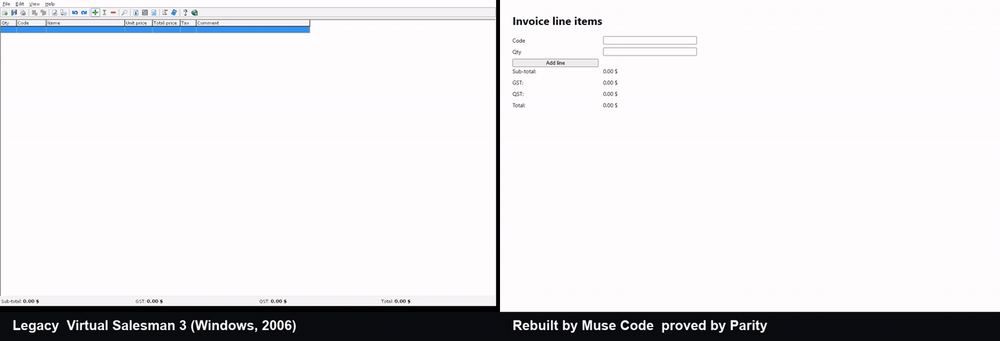
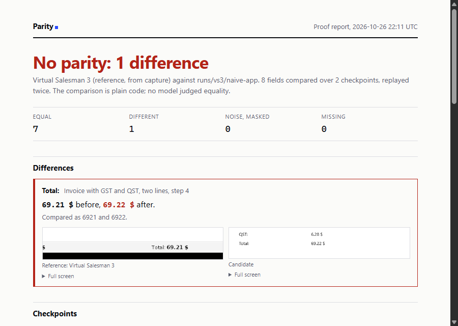

# Parity

**Parity rebuilds old business software as a modern web app, and proves the new app does exactly what the old one did.**



Left: Virtual Salesman 3, a Windows sales app from 2006, recorded under Wine. Right: the web app Muse Code built from that recording. Parity replayed the same invoice on the rebuilt app and compared it with the recorded screens: 8 of 8 fields equal, first try, $0.46.

Point it at an app nobody fully understands anymore. Parity watches it being used, explores it on its own, writes down its business rules in plain language for an expert to confirm, generates the new app, then replays the same scenarios until every field matches. The proof stays: replay it after any later change, by a person or an AI coding agent, and see every field that moved.

```
record ─► explore ─► rules ─► rebuild ─► prove ─► keep proving
```

| step        | what happens                                                                                                      | Meta model                                 |
| ----------- | ----------------------------------------------------------------------------------------------------------------- | ------------------------------------------ |
| **Record**  | A narrated screen recording of someone using the old app ("the Quebec tax always goes on top of the federal tax") | Muse Voice Transcribe                      |
| **See**     | Fields and values are read from every key frame                                                                   | Muse Spark, SAM 3.1 for overlays           |
| **Explore** | The agent drives the app alone to reach screens the recording missed                                              | Muse Spark computer use                    |
| **Rules**   | Business rules in plain language, each with its evidence, formulas checked against the recorded values by code    | Muse Spark, Muse Wonder for contradictions |
| **Rebuild** | A web app generated from the rules, then repaired difference by difference                                        | Muse Code                                  |
| **Prove**   | Every scenario replayed, fields matched and compared                                                              | none: plain code                           |

## The one cent

Every line of an invoice looks right and the total is one cent off. Virtual Salesman 3 adds the unrounded taxes and rounds once; a rebuild that adds the rounded amounts shows 69.22 instead of 69.21. Parity catches it and puts the two screens side by side in a one-page report, ready to sign:



## Try it in two minutes, no API key

Needs [Bun](https://bun.sh) 1.3 or later and Chrome or Chromium (`PARITY_CHROME_PATH` to point at one). The browser runs headless with a throwaway profile.

```sh
git clone https://github.com/GlamgarOnDiscord/parity-agent.git
cd parity-agent
bun install
bun test                                                           # 85 tests, some in headless Chrome
bun run prove                                                      # the one-cent difference, field by field
bun run prove --fixed                                              # the corrected rebuild: parity
bun run report --proof fixtures/proofs/vs3-invoice.json --fixture  # writes runs/report.html
```

`prove` and `report` exit with code 1 when they find a difference, like a failing test, so they can gate a CI job.

```
Reference: Virtual Salesman 3   Candidate: http://127.0.0.1:40941/   (996 ms, 2 runs each)
Volatile, masked: Printed at, Reference

s2-invoice-gst-qst › invoice (step 6)
  = Sub Total: 59.94               Subtotal: $59.94
  ✗ Total: 69.21                   Total: $69.22
  = GST (5%): 3.00                 Federal tax (GST 5%): $3.00
  = QST (9.975%): 6.28             Provincial tax (QST 9.975%): $6.28
  ✗ Balance: 49.21                 Balance due: $49.22
  ...
  8 equal, 2 different, 0 masked, 0 missing

NO PARITY: differences above.
```

## The whole pipeline

Model calls need a Meta Model API key: `cp .env.example .env` and set `MODEL_API_KEY`. Every call is logged with its cost and the bytes sent, and refused once `PARITY_BUDGET_USD` (default 20) is spent.

| command                                                | what it does                                                                                        | model calls    |
| ------------------------------------------------------ | --------------------------------------------------------------------------------------------------- | -------------- |
| `bun run models:check`                                 | one real call per Meta model                                                                        | a few cents    |
| `bun run capture <video>`                              | key frames, transcript, fields per frame, rules with evidence                                       | yes            |
| `bun run dev`                                          | local screens (link printed at launch): rules to accept or reject with their evidence, and the diff of the last replay, coverage first | none           |
| `bun run rebuild runs/<run>`                           | Muse Code builds the app from the accepted rules, Parity proves it and asks for repairs             | yes, Muse Code |
| `bun run prove --proof <proof.json> --url <app>`       | replays a proof on any web app                                                                      | none           |
| `bun run report runs/<run>`                            | the one-page proof report, with both screens zoomed on each difference                              | none           |
| `bun run record:reference <scenario.json> --url <app>` | records a web app as the reference over several runs and measures its noise                         | none           |
| `bun run explore <proof.json> --url <app>`             | Muse Spark computer use explores the app and reports screens the proof never checked                | yes, capped    |
| `bun run parity fuzz <spec.json> --proof <proof.json> --reference-url <legacy> --app <dir>` | generates cases from a seed, plays each on both apps, shrinks every difference and adds it to the proof; `--repair` hands them to Muse Code | none; `--repair` uses Muse Code |
| `bun run export:playwright runs/<run>`                 | a standalone Playwright test from a proof                                                           | none           |
| `bun run record:replay runs/<run>`                     | films the rebuilt app and puts it next to the legacy recording                                      | none           |

Muse Code runs headless (`muse exec`), always on the Standard model; Parity refuses a run that reports a `-contributor` model.

A second app nobody here wrote, FrontAccounting 2.4.20 (GPL, downloaded and hash-checked, never committed), runs in Docker:

```sh
sh sandboxes/frontaccounting/fetch.sh
docker compose -f sandboxes/frontaccounting/compose.yaml up -d --build
bun run record:reference fixtures/scenarios/frontaccounting-invoice.json --url http://127.0.0.1:8080/ --runs 5
bun run prove --proof fixtures/scenarios/frontaccounting-invoice.proof.json --url http://127.0.0.1:8080/
```

## Measured, not claimed

| what                                                                             | result                                                      |
| -------------------------------------------------------------------------------- | ----------------------------------------------------------- |
| Virtual Salesman 3, 32 s recording                                               | 6 key frames, 6 rules, 5 formulas checked, no contradiction |
| VS3 rebuilt by Muse Code from those rules                                        | parity on 8 of 8 fields, first try, $0.46                   |
| VS3 capture, rules and rebuild together, including reruns while building Parity  | 29 model calls, 1.68 MB sent, $1.58                         |
| FrontAccounting invoice, 5 replays                                               | 63 fields, 4 noisy, 3.3 s per run                           |
| Exploration of FrontAccounting by Muse Spark computer use                        | 12 steps, 4 screens the recording never showed, $0.153      |
| Report on a rebuild that adds rounded taxes                                      | 1 difference: 69.21 before, 69.22 after                     |
| Fuzzing the FrontAccounting rebuild against the live app, 12 invoices            | 3 items the recording never showed, each shrunk to one or two lines; fixed by one $0.46 repair, then 52 fresh invoices at parity |

Details and method: [docs/benchmarks.md](docs/benchmarks.md). Verified API behaviour: [docs/meta-api.md](docs/meta-api.md).

## Principles

- **AI never decides what "the same" means.** Matching and comparison are plain code. AI captures, proposes and explains.
- **Noise is measured, not guessed.** Each scenario runs at least twice on the same app; a field that changes on its own (an invoice number, a timestamp) is masked and shown as masked, per grid row when labels repeat.
- **Nothing leaves your machine unless you send it.** The server listens on 127.0.0.1. Replays and diffs run offline. The browser Parity drives can reach the app under test and nothing else: other origins, other ports, WebSockets, WebRTC and popups are blocked, and a test covers each one.
- **The agent does not get a blank cheque.** Exploration has a step and a dollar cap, stops on any safety check unless the operator acknowledged that exact code for a local app, and lists every acknowledged action.
- **A clean report is never silent.** Fields with no counterpart and fields never tested are listed, not dropped.

## Status

| part                                                         | status                                                        |
| ------------------------------------------------------------ | ------------------------------------------------------------- |
| Field matching across two UIs with different labels          | done                                                          |
| Replay, field diff, noise detection, old table layouts       | done (web apps)                                               |
| Capture from a recording, rules with evidence, review screen | done                                                          |
| Rebuild and repair with Muse Code                            | done                                                          |
| Coverage map, send log per run, Playwright export            | done                                                          |
| Second app, autonomous exploration                           | done                                                          |
| One-page proof report                                        | done                                                          |
| `parity` CLI, GitHub Action on pull requests, MCP server, offline proof | done                                               |
| Differential fuzzing with shrinking, against live FrontAccounting | done                                                     |
| Muse Spark Open on Baseten for on-premise rule extraction    | client ready, not verified (no key yet)                       |
| Replaying the Windows app itself instead of its recording    | cut: the recording is the reference ([D3](docs/decisions.md)) |

Plan and exit checks: [docs/sprints.md](docs/sprints.md).

## Design choices

Browser drivers and model clients are chosen by configuration, so they can be benchmarked and swapped ([docs/decisions.md](docs/decisions.md)). Stack: Bun, TypeScript, Hono, SQLite, Zod, Puppeteer over CDP, the Vercel AI SDK and the OpenAI SDK pointed at the Meta Model API.

## Research behind it

Before writing code, the idea went through a product review: a board of three framework lenses, a competitor map, a simulated buyer panel (15 % would try the first pitch, 40 % the revised offer), pricing, a credit budget and a launch plan. All of it is in [`founder/`](founder/summary.md), with the pitch in [`docs/pitch.md`](docs/pitch.md). The panel is simulated and the numbers are projections.

## Licence

[Apache-2.0](LICENSE). The legacy apps used as examples are not part of this repository: Virtual Salesman 3 is not redistributed, and FrontAccounting (GPL-3.0-or-later) is downloaded by `sandboxes/frontaccounting/fetch.sh`.
